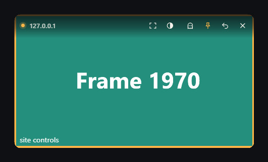

# Perch

**Float any video above every app on your PC.** The floating window has no frame,
resizes to any size, and stays on top while you game, code or work. It runs the site's
own player, so subtitles, live streams, quality settings and your logins all keep working.

Works in Chrome, Edge and Brave on Windows 10 and 11.

## Why not Picture-in-Picture?

Browser Picture-in-Picture limits you in four ways:
- It caps the window size.
- It keeps a title bar.
- It shows one video at a time.
- It often drops subtitles (Crunchyroll, for example).

Perch doesn't use Picture-in-Picture. It moves the whole tab into a window of its own,
lets the site's player fill it, and removes the browser frame around it.

## Install

You need Windows 10 or 11 and Chrome, Edge or Brave.

1. **Download** `Perch-v0.1.1.zip` from the
   [latest release](https://github.com/NurraLLC/perch/releases/latest). Unzip it somewhere
   permanent, such as `Documents\Perch`. The browser loads the extension from that
   folder, so don't delete it.
2. **Install the helper.** Double-click `install-helper.cmd`.
   - It builds a ~25 KB helper from `helper/PerchHelper.cs` with the C# compiler that ships with Windows.
   - It installs to `%LOCALAPPDATA%\Perch` for your user only; no admin needed.
   - It registers the helper with Chrome, Edge and Brave.
3. **Load the extension:**
   - Open `chrome://extensions` (or `edge://extensions`).
   - Turn on **Developer mode** and click **Load unpacked**.
   - Choose the `extension` folder.
4. Click the Perch icon. The popup should say **Helper on**.

Without the helper, Perch still floats the video, but as a normal browser window that
doesn't stay on top.

## Use it

- **Float:**
  - Hover a video and click **Float**, or press **Alt+P** on any page.
  - The video lifts into its own window at the bottom-right of your screen.
- **Move:** drag the top bar. It snaps to screen edges, and each site remembers where you left it.
- **Resize:**
  - Drag any edge or corner.
  - Hold **Shift** to keep the video's shape.
  - Double-click the bar to fit the window to the video.
- **Back:** press **Esc** or click ↩. The tab returns to where it was, still playing.

**Top bar:**

| Button | What it does |
|---|---|
| ⛶ | Fit the window to the video |
| 💬 | Float the live chat beside the video (Twitch, Kick, YouTube live) |
| ◐ | Opacity: 100 → 85 → 70 → 50% |
| 👻 | Ghost: clicks pass through to the app underneath, and it fades further while your cursor is over it |
| 📌 | Keep above other apps (on by default) |
| ↩ | Back to the tab |
| ✕ | Close the video |

**Shortcuts that work from any app:**

| Keys | Action |
|---|---|
| Ctrl+Alt+G | Ghost on/off (the way back from Ghost mode) |
| Ctrl+Alt+P | Play/pause the float |
| Ctrl+Alt+H | Hide or show all floats |

**Sites:**
- The Float button appears on YouTube, X, Twitch, Kick and Crunchyroll.
- To get it on every site, turn on **Float button on every site** in the popup.
- **Alt+P** works on any site even without that.

## How it works

1. **New window:** the extension moves the tab into its own browser popup window.
2. **Fill mode:** it tells the site's player to fill that window. The site's own
   fullscreen button fills the window instead of the monitor, so the site keeps its
   fullscreen layout and subtitles.
3. **Frameless host:** the helper places the browser window inside a frameless,
   always-on-top window of its own. It's offset so the browser's title and address bars
   fall outside and are cropped away. Moving, resizing, snapping, opacity and Ghost
   mode all happen on that outer window.
4. **Same browser:** the browser still draws the page, so protected video, ads,
   quality settings and sign-ins behave exactly as in a normal tab.

## Privacy

Perch has no servers, analytics or accounts, and makes no network requests of its own.
It stores only your settings and per-site window positions, locally in your browser.

## Status

This is an early release. Tested so far:
- A real browser popup window: frameless crop, clicks, opacity, Ghost click-through, drag, resize, fit, release.
- The full extension in a clean browser profile.
- YouTube, and X single posts. Quoted posts in the X feed are fixed in v0.1.1 and verified
  against a reproduction of X's feed rebuild.

**Not yet verified:**
- Twitch, Kick and Crunchyroll.
- Chat floats.
- Opacity and Ghost on DRM-protected video.

If Ghost turns protected video black, turn off hardware acceleration in your browser
(Settings → System).

Found a site where it misbehaves? Please [open an issue](../../issues) with the site and what happened.

## Uninstall

Run `install-helper.cmd -Uninstall`, then remove the extension.

## Project layout

| Path | Contents |
|---|---|
| `extension/` | MV3 extension: service worker, content script, page-world fullscreen redirect, popup |
| `helper/PerchHelper.cs` | Native-messaging helper: host windows, drag/resize/snap, opacity, Ghost, global hotkeys |
| `install-helper.cmd` / `.ps1` | Builds and registers the helper for the current user |
| `tools/` | Icon generator and end-to-end checks against real browser windows |

## License

[MIT](LICENSE). © 2026 NURRA LLC. Not affiliated with YouTube, X, Twitch, Kick or Crunchyroll.
